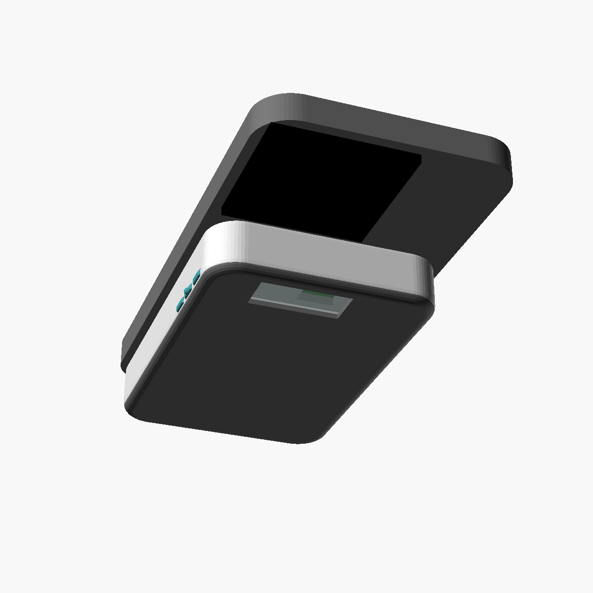
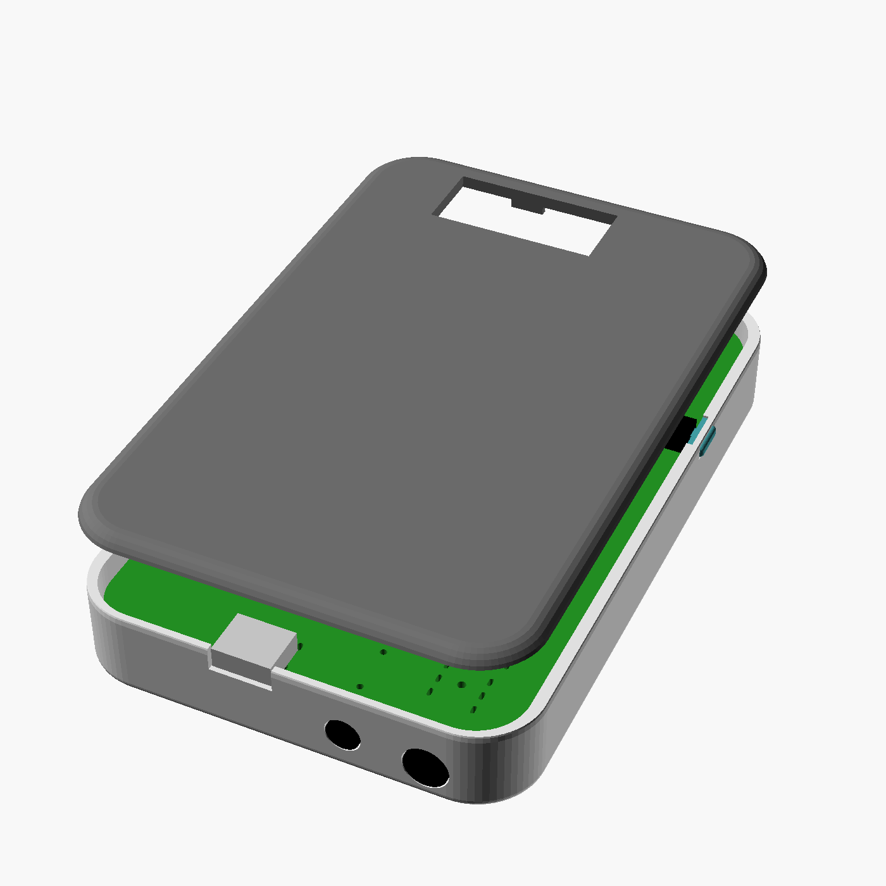
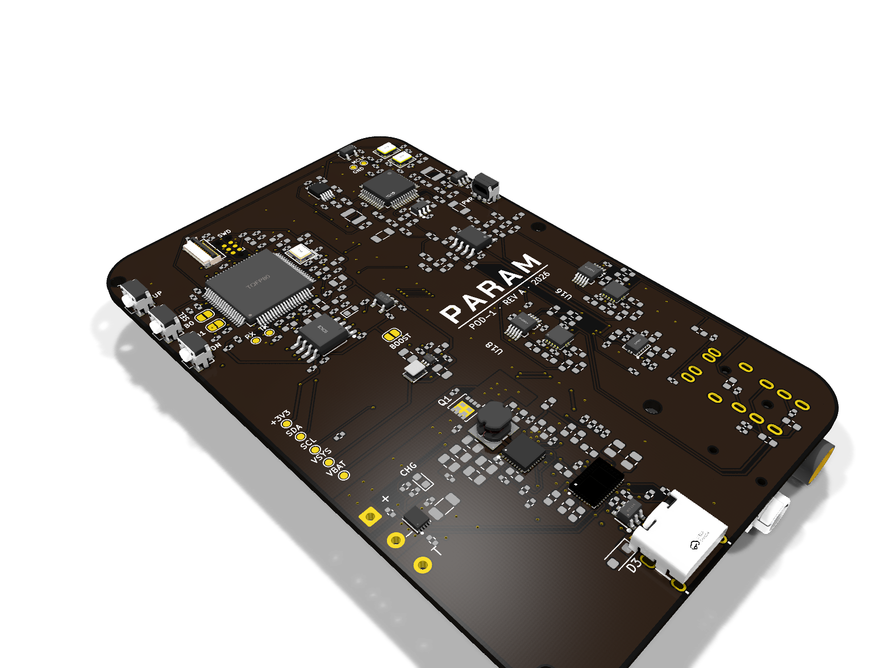

# PARAM POD (POD-1)

**MagSafe Audiophile DAC & Headphone Amplifier**  
*Part of the PARAMWORKS Open Hardware Collection*  
*Operating Entity: Nirvaan LLC*

[](LICENSE)
[](https://paramworks.com)

---

## Overview

**PARAM POD** is a portable, high-fidelity digital-to-analog converter (DAC) and headphone amplifier designed to snap magnetically (MagSafe) directly to the back of your smartphone.

Most high-end portable audio dongles and DAC bricks create two major problems: they drain your smartphone's battery in a few hours, or they require awkwardly rubber-banding a heavy, separate power brick to your device.

PARAM POD solves both:
1. **Zero Phone Drain:** Its onboard ~2,500 mAh LiPo pack powers the power-hungry DAC and analog output stages independently, keeping your phone's battery intact.
2. **Emergency Reverse Charging:** Featuring a bidirectional USB Power Delivery (USB-PD) controller, it can reverse-charge your phone at up to ~1A when you are in a pinch.
3. **Bit-Perfect Lossless Playback:** Uncompromised UAC2 audio transmission from bit-perfect apps (Roon ARC, Tidal, Qobuz) directly over a short, low-profile right-angle USB-C bridge.

```
 Phone (Roon ARC / Tidal) ──USB-C, UAC2──▶ NXP i.MX RT1011 ──I2S──▶ AK4493SEQ DAC ──▶ Balanced Amp ──▶ 3.5mm / 4.4mm
        ▲                                        ▲                       ▲
        │                                        └────── MCLK (DAC Master)
        └── USB-PD Power Path (Bidirectional) ── TPS25750D ⇄ BQ25792 ⇄ 1S LiPo Cell (~2500 mAh)
```

---

## Visual Design & Hardware Renders

### Final Product (MagSafe Snapped to Smartphone)


### Exploded Enclosure & Hardware Stack


### Audiophile PCB (Matte Black Solder Mask · ENIG Gold Finish)
*Raytraced 3D render of the Rev 1 PCB featuring the AK4493SEQ Velvet Sound™ DAC, NXP i.MX RT1011 USB core, TI BQ25792 charger, and TI TPS25750D USB-PD controller.*


---

## Technical Specifications

| Parameter | Specification |
|:---|:---|
| **DAC Architecture** | Asahi Kasei AK4493SEQ Velvet Sound™ 32-bit Stereo DAC |
| **Microcontroller / USB Core** | NXP i.MX RT1011 (ARM Cortex-M7 @ 500 MHz, 128KB SRAM) |
| **Clocking Architecture** | Ultra-low phase noise dual audio oscillators (22.5792 MHz & 24.576 MHz) · DAC side clock master |
| **Audio Protocol** | USB Audio Class 2.0 (UAC2) Asynchronous · Zero driver installation required on iOS/macOS/Linux/Windows |
| **Analog Outputs** | 3.5mm Single-Ended (TRS) & 4.4mm Pentaconn Balanced (TRRRS) |
| **Power Controller** | Texas Instruments TPS25750D USB Type-C and USB PD Controller |
| **Battery Charger** | Texas Instruments BQ25792 I2C Controlled 1S-4S NVDC Buck-Boost Charger with OTG / Reverse Boost |
| **Internal Battery** | 1S LiPo pouch cell (~2,500 mAh with integrated PCM protection) |
| **Mounting** | Embedded MagSafe array (36-magnet ring + alignment magnet) |

---

## Repository Structure

```
├── 3d-printing/                # Ready-to-print STLs for MagSafe enclosure
│   ├── pod_box.stl             # Main enclosure body with MagSafe ring pocket
│   ├── pod_lid.stl             # Snapping top lid
│   ├── cap_tree_nubs_0_15.stl  # Tactile button caps (0.15mm tolerance)
│   └── cap_tree_nubs_30_45.stl # Tactile button caps (0.30mm tolerance)
├── renders/                    # 3D product and black ENIG PCB renders
│   ├── pod_assembled.png       # Final MagSafe assembled product view
│   ├── pod_exploded.png        # Exploded enclosure stack
│   └── param_pod_black_enig.png# Raytraced black solder mask + ENIG PCB
├── schematics/                 # Reference schematics in PDF format
│   └── param-pod-schematic.pdf
├── firmware/                   # Open-source UAC2 firmware for NXP i.MX RT1011
│   ├── CMakeLists.txt
│   ├── board/                  # Board clock, pinmux, and SAI configurations
│   ├── src/                    # TinyUSB audio descriptor stack and AK4493 driver
│   ├── build.sh                # Compilation script
│   └── deps.sh                 # NXP MCUXpresso and TinyUSB dependency fetcher
└── LICENSE                     # MIT License
```

---

## 3D Printing & Enclosure

Enclosure files are located in [`3d-printing/`](3d-printing/):
* **Recommended Material:** MJF Nylon PA12 (Black) or High-Temp SLA Resin.
* **Magnets:** Standard 54mm OD × 46mm ID × 1.5mm MagSafe neodymium ring + vertical orientation bar.
* **Fastening:** Snap-fit lid with internal alignment ribs and captive battery cradle.

---

## Firmware Compilation

The firmware is built on top of [TinyUSB](https://github.com/hathach/tinyusb) and the NXP MCUXpresso SDK.

```bash
cd firmware

# Fetch external dependencies
./deps.sh

# Build ARM Cortex-M7 binary
./build.sh
```

Flashing is handled via SWD during factory testing, or over USB via the NXP ROM bootloader.

---

## Philosophy & Licensing

Built with zero telemetry, zero cloud dependency, and local-first architecture under **Nirvaan LLC**.

* **Software & Firmware:** Licensed under the [MIT License](LICENSE).
* **Reference Schematics & 3D Models:** Open hardware reference design under MIT.
